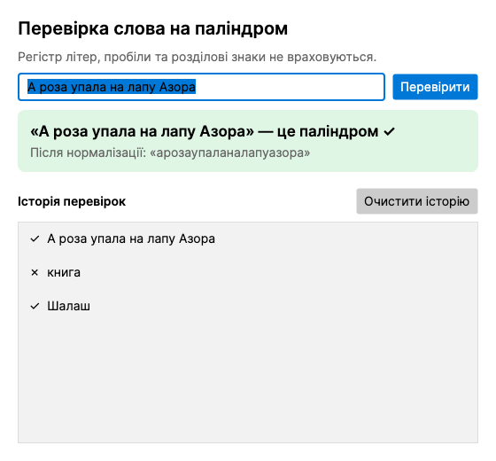
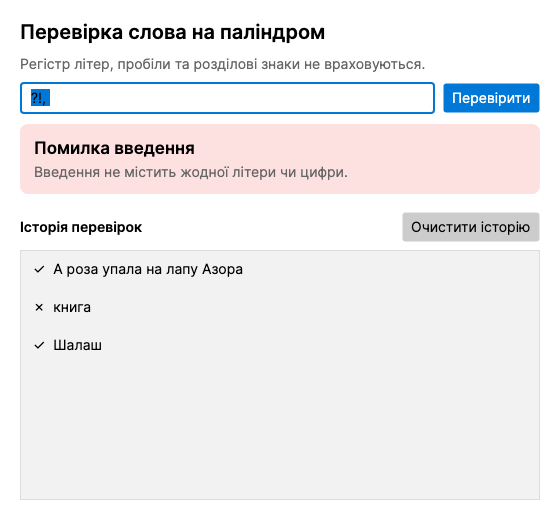

# Лабораторна робота №3 — Перевірка слова на паліндром

Графічний застосунок на C# (.NET), який перевіряє, чи є введене слово (або фраза) паліндромом, **ігноруючи регістр літер і розділові знаки**.



## Чому Avalonia UI, а не Windows Forms / WPF

Роботу виконано на **macOS**, а Windows Forms і WPF працюють **лише в Windows**. Тому використано **[Avalonia UI](https://avaloniaui.net/)** — кросплатформний аналог WPF для C# (розмітка XAML, ті самі елементи керування та події). Класи логіки не залежать від інтерфейсу й без змін переносяться у Windows Forms / WPF.

## Інтерфейс

- Поле введення слова або фрази та кнопка **«Перевірити»** (або Enter).
- Результат: зелений — паліндром, помаранчевий — ні, червоний — помилка введення. Також показано рядок після нормалізації.
- **Історія перевірок** і кнопка «Очистити історію».

## Структура (ООП)

| Файл | Клас | Відповідальність |
|------|------|------------------|
| `InputValidator.cs` | `InputValidator` | Перевірка та нормалізація введення: прибирає пробіли й розділові знаки, переводить у нижній регістр |
| `InputValidator.cs` | `InvalidInputException` | Власний тип винятку для некоректного введення |
| `PalindromeChecker.cs` | `PalindromeChecker` | Визначення паліндромності (порівняння символів з двох кінців) |
| `PalindromeTests.cs` | `PalindromeTests` | Набір тестових випадків |
| `MainWindow.axaml` / `.axaml.cs` | `MainWindow` | Інтерфейс користувача: введення та виведення результату |
| `App.axaml`, `Program.cs` | `App`, `Program` | Запуск застосунку та режим тестування |

`PalindromeChecker` отримує `InputValidator` через конструктор, тож обробку введення відокремлено від логіки перевірки.

## Обробка помилок

- порожній ввід або лише пробіли → `Введення порожнє…`
- ввід без жодної літери чи цифри (напр. `?!,`) → `Введення не містить жодної літери чи цифри.`

Помилки перехоплюються в обробнику кнопки (`MainWindow`) і показуються у вікні, тож програма не закривається.



## Тестування

Тестові входи: слова з великими й малими літерами (`Шалаш`, `Racecar`), фрази з пробілами та розділовими знаками (`А роза упала на лапу Азора`, `A man, a plan, a canal: Panama!`), числа, одна літера, не-паліндроми, а також некоректні вводи.

```bash
dotnet run -- --test
```

Результат: `Пройдено 17 з 17 тестів.`

## Документування коду

Класи та публічні методи описано XML-коментарями (`/// <summary>`), що відображаються як підказки в IDE.

## Оптимізація та продуктивність

- Перевірка використовує два індекси, що рухаються з кінців до середини: складність **O(n)**, без створення перевернутої копії рядка.
- Перевірка зупиняється на першій розбіжності, тож більшість не-паліндромів відсіюється за кілька порівнянь.
- Нормалізація рядка виконується один раз за прохід.

## Запуск

Потрібен [.NET SDK](https://dotnet.microsoft.com/download) 10. Пакети Avalonia завантажуються автоматично.

```bash
dotnet run
```

